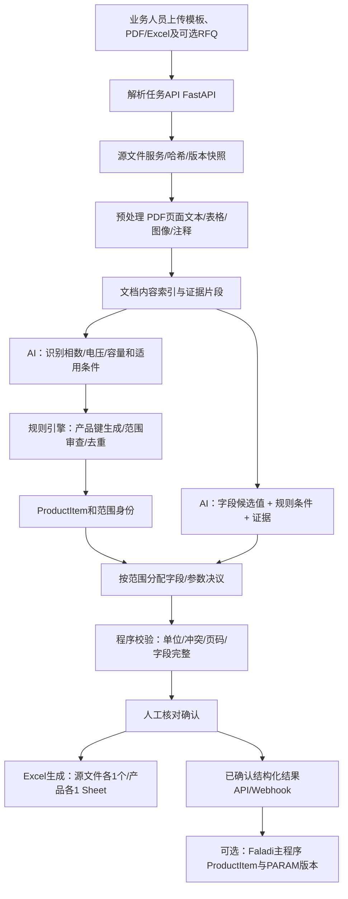

# 00｜总体架构与端到端流程

> 状态：实施设计 / 2026-10-10。仓库目前没有应用代码；本文提出建议架构，不表示已实现。以《参数确认表》为字段规范，以每份原始客户文档为事实来源。

## 1. 要解决的业务问题

**输入**：一次解析任务包含一份参数模板（当前示例为31字段）+ N份客户文件（PDF/Excel/Word；初版优先 PDF/Excel）+ 可选 RFQ/订单/澄清文件（需显式关联来源文档）。

**输出**：
- 一份《全任务识别统计》：源文件、大类数、`STANDARD_SERIES`规格数、`EXPLICIT_SPEC`规格数、已确认采购规格数、待确认问题；
- **每份源客户文件恰好一个独立 .xlsx**；该文件导出范围中的每个具体产品独立一张 Sheet；每张 Sheet 的参数字段取自该次模板且不丢失；
- 一套机器可读 JSON（产品、参数、原文证据、规则、冲突、状态），供审核和主程序后续使用。

## 2. 架构边界

**职责划分**：
- AI 只提出：候选信息、结构化语义、适用范围、证据定位；不直接控制 Sheet 数量、字段数、正式采购数量。
- 确定性代码控制：模板读取、文档隔离、去重、范围匹配、校验、命名、导出文件与工作表数量、不可变审计。
- 人工处理：原文冲突、模糊适用范围、明确订单与标准的矛盾、原文无法验证的高风险候选。
- 如果接 Faladi：A 子系统管理解析进度与证据；主程序只接收确认后的结构化产品/参数快照，正式生成 PARAM-V1；A 独立处理上传/解析/核对，避免将业务逻辑塞入主程序。

## 3. 整体步骤清单：每一步究竟干什么

| 步骤 | 输入 | 具体动作（谁做） | 生成成果 | 通过标准 |
|---|---|---|---|---|
| 00 创建任务 | 项目、模板、多个源文件 | API 建任务，快照模板和每个文件哈希，设置导出范围 | `taskId/documentId/templateVersion` | 任意文件可独立追溯 |
| 01 模板解析 | 参数确认表xlsx | 程序读取字段名/顺序/单位/必填，字段代码和参考值 | `FieldDefinition[]` | 完全与模板一致，重复/空名报错 |
| 02 文件预处理 | 每份 PDF/Excel | 程序分文档读取页、文本、表格、批注，建立段落索引 | `DocumentPage[]`、`EvidenceBlock[]` | 能跳到原始页/工作表/单元格 |
| 03 识别基础维度 | 页面/段落/表格 | AI 查“相数/高压/低压/容量”，同时找证据与限定语 | `SeriesCandidate[]` | 值和证据均可核对 |
| 04 分析适用范围 | Scope、Ratings、Annex、RFQ | AI + 规则标记标准全系列、明确项目规格、订单规格；冲突待审 | `ScopeClaim[]` | 9容量不会直接被当作已采购9款 |
| 05 展开产品行 | 系列候选 + 适用范围 | 程序**只展开原文支持的组合**，归一化电压、四维去重 | `ProductItem[]` | 400/230V不重复；11/22kV不合并 |
| 06 查找参数规则 | 参数字段+原文 | AI 分字段抽取 W/%/K/Hz 等值、比较符、适用容量区间与页码 | `ParameterRuleCandidate[]` | 75kVA损耗仅锁定75；<等条件明确 |
| 07 参数继承/决议 | ProductItem + 参数规则 | 程序按“专属→条件→真正通用”匹配，未给留空并写状态 | `ProductFieldDecision[]` | 每产品字段数等于模板字段数 |
| 08 交叉核验 | 字段决议 + 原文索引 | 校验单位/数值语义、证据存在、范围吻合、冲突及未知 | `ValidationIssue[]` | 高危冲突不会静默通过 |
| 09 人工审查 | 产品列表+异常+证据 | 可编辑值、范围身份、排除/包含规格、冲突决议；留修改轨迹 | `ReviewAction[]` | 所有阻断项关闭才可最终确认 |
| 10 产品命名 | 确认字段 | 程序固定拼接8段命名，待定字段用待定值 | `productName` | 不把允差百分比作为损耗W |
| 11 导出 Excel | 导出范围 + 模板 + 决议 | 按原始文件独立导出、按产品 Sheet、独立写全字段和证据 | N 个 `.xlsx` + 汇总.md | 文件数、Sheet数、字段数精确匹配 |
| 12 可选正式交付 | 已确认结构化结果 | A 推送回调，主程序安全拉取/建档/创建正式版本 | `PARAM-V1`等 | 幂等且可重试，非确认结果不能入库 |

## 4. 产品识别与参数分配绝对不能混为一谈

文件可以在 §5.5.1 枚举9个容量，但在损耗表只给75kVA：**先形成9个标准系列规格候选，再将200W/910W分配给75kVA**。不是因为有9个容量就证明9个容量均有完整产品参数，更不是证明采购9台。

业务维度：
- `productClassKey = phase + ratedHvKv + ratedLvLineKv`
- `productKey = productClassKey + capacityKva`
- `documentProductKey = sourceDocumentId + productKey`（产品在源文件中的独立性）
- 跨文档去重仅用于单独的“全局规格相同度”指标，绝不能回填另一个文档的参数。

数值语义：
- `200W` = 75kVA 空载损耗规范限值（如文件指明），不是 `+10%` 允差；
- `4%` = ≤315kVA 阻抗上限，不能当实测或供应商保证值；
- `400/230V` = 三相线电压400V/相电压230V，同一低压系统、低压产品键采用0.4kV；
- `Um 12kV` = 设备最高电压，不是11kV产品的新额定高压。

## 5. 检验例：EDM两份源PDF

| 原PDF | §1 Scope指定 | §5.5.1标准容量 | 全标准系列 Sheet | 实际订单是否确认 |
|---|---|---|---:|---|
| 11kV文件 | 75kVA | 50/75/100/160/200/250/315/500/630 | 9 | 否 |
| 22kV文件 | 75kVA | 50/75/100/160/200/250/315/500/630 | 9 | 否 |

因此 **“18 个具体规格”仅适用于 `STANDARD_SERIES` 全系列展开**。若前台选择“明确规格”模式，则应提示两份均由 Scope 点名75kVA（22kV附录容量留空）；若选“已采购”，在缺少订单时不可直接生成已确认统计。

## 6. 可先做独立服务，不需要先做 UI

建议第1周仅做命令行流水线：`template.xlsx + docs/*.pdf → manifest.json + evidence.json + products.json + decisions.json → 逐产品Excel`。此时所有 AI 输出都保存原始结果用于重放；确认算法可靠后再上任务API、审核UI和异步队列。

下一步：[01 逐步开发实施手册](01-逐步开发实施手册.md)。
