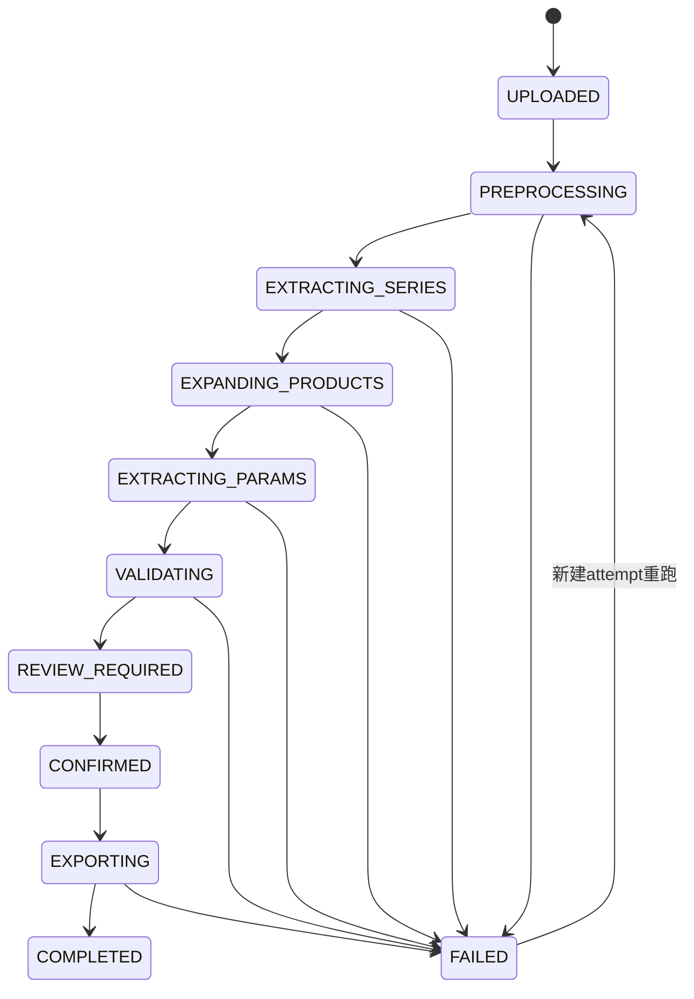

# 03｜数据库与接口设计（建议方案）

> 场景：解析子系统 A（可独立部署）管理任务、证据、产品和审查；如未来接 Faladi 主程序，只同步**已确认快照**。本仓库为空仓库，以下表/接口均为建议，不是已存在实现。

## 一、MySQL 设计原则

- 所有业务实体显式带 `tenant_id`、`task_id`（如适用），跨租户/跨项目请求必须校验授权。
- 解析输入**不可变**：原文件 hash、模板版本、模型调用原文、证据快照保留；同一任务重跑新建 attempt，不直接覆写旧结果。
- 源文档产品键 `document_id + phase + hv_kv + lv_kv + capacity_kva`唯一（在**同次有效解析版本**内）；显示产品名不当主键。
- 结构化候选与确认后的决议分表，版本分离，确保复核能够追溯“AI最初说什么、规则怎么改、审核人最终定什么”。
- 样例 SQL 为 MySQL 8.x 风格；正式建库用迁移工具管理，金额/电压/容量避免浮点，采用DECIMAL；物理主键可用 `CHAR(26) ULID` 或 UUID。

## 二、核心表及关系

| 表 | 主键及关键外键 | 保存什么 |
|---|---|---|
| `parse_task` | id | 项目、租户、导出模式、状态、创建人、配置版本 |
| `parameter_template` | id | 原始模板文件hash、字段定义版本 |
| `template_field` | id, template_id | 字段代码、名称、顺序、单位、类别、参考值 |
| `source_document` | id, task_id | 客户源文档、类型、哈希、路径、源文件序号 |
| `document_relation` | id | 源文件与RFQ/PO/澄清附件的绑定关系 |
| `evidence_block` | id, document_id | 页码、原文片段、bbox/表格/批注、来源类型 |
| `parse_attempt` | id, task_id | 单次运行，模型/提示词/规则版本、状态和耗时 |
| `series_candidate` | id, attempt_id | AI识别的相数/电压/候选容量和原始结构 |
| `scope_claim` | id, attempt_id | STANDARD_SERIES/EXPLICIT_SPEC/ORDER_CONFIRMED 及证据 |
| `parsed_product` | id, attempt_id, document_id | 四维唯一产品行、显示名称、包含/排除 |
| `parameter_rule` | id, attempt_id, document_id | 规则值/单位/条件/运算符/语义/候选证据 |
| `product_field_decision` | id, product_id, field_id | 每个产品每个字段的决议、缺失/冲突状态 |
| `field_decision_evidence` | decision_id, evidence_id | 多对多，字段决议的原文依据 |
| `review_action` | id, task_id | 人工审核修改前后、原因、操作者 |
| `confirmed_snapshot` | id, task_id | 已确认产品+参数集合及版本、哈希 |
| `export_artifact` | id, snapshot_id | 每份客户文件Excel路径、sheet数、校验摘要 |
| `outbox_event` | id, snapshot_id | 同步主程序的待发送事件、重试计数 |

## 三、关键表 DDL 示例

下列 DDL 仅示例核心约束，`tenant_id` / `created_by` / 审计表字段在实际迁移中应统一补齐：

```sql
CREATE TABLE parse_task (
    id              CHAR(26) PRIMARY KEY,
    tenant_id       VARCHAR(64) NOT NULL,
    project_id      VARCHAR(64) NULL,
    template_id     CHAR(26) NOT NULL,
    export_mode     VARCHAR(32) NOT NULL DEFAULT 'STANDARD_SERIES',
    status          VARCHAR(32) NOT NULL DEFAULT 'UPLOADED',
    current_attempt_id CHAR(26) NULL,
    created_by      VARCHAR(64) NOT NULL,
    created_at      DATETIME(3) NOT NULL DEFAULT CURRENT_TIMESTAMP(3),
    updated_at      DATETIME(3) NOT NULL DEFAULT CURRENT_TIMESTAMP(3)
                       ON UPDATE CURRENT_TIMESTAMP(3),
    INDEX idx_task_tenant(tenant_id, created_at)
);

CREATE TABLE source_document (
    id              CHAR(26) PRIMARY KEY,
    task_id         CHAR(26) NOT NULL,
    tenant_id       VARCHAR(64) NOT NULL,
    file_name       VARCHAR(255) NOT NULL,
    sha256          CHAR(64) NOT NULL,
    mime_type       VARCHAR(100) NOT NULL,
    storage_key     VARCHAR(512) NOT NULL,
    role_type       VARCHAR(32) NOT NULL DEFAULT 'CUSTOMER_SPEC',
    file_order      INT NOT NULL,
    page_count      INT NULL,
    created_at      DATETIME(3) NOT NULL DEFAULT CURRENT_TIMESTAMP(3),
    INDEX idx_document_task(task_id, role_type),
    INDEX idx_document_hash(sha256)
);

CREATE TABLE parsed_product (
    id              CHAR(26) PRIMARY KEY,
    attempt_id      CHAR(26) NOT NULL,
    document_id     CHAR(26) NOT NULL,
    phase           VARCHAR(4) NOT NULL,
    hv_kv           DECIMAL(12,5) NOT NULL,
    lv_line_kv      DECIMAL(12,5) NOT NULL,
    capacity_kva    DECIMAL(15,5) NOT NULL,
    scope_tags      JSON NOT NULL,
    product_name    VARCHAR(500) NULL,
    review_status   VARCHAR(32) NOT NULL DEFAULT 'PENDING',
    included        TINYINT(1) NOT NULL DEFAULT 1,
    UNIQUE KEY uk_product_in_attempt (
        attempt_id, document_id, phase, hv_kv, lv_line_kv, capacity_kva
    )
);

CREATE TABLE parameter_rule (
    id              CHAR(26) PRIMARY KEY,
    attempt_id      CHAR(26) NOT NULL,
    document_id     CHAR(26) NOT NULL,
    field_code      VARCHAR(50) NULL,
    semantic_name   VARCHAR(100) NOT NULL,
    raw_value       TEXT NULL,
    value_normalized VARCHAR(100) NULL,
    unit            VARCHAR(32) NULL,
    operator_code   VARCHAR(16) NULL,
    semantic_type   VARCHAR(40) NOT NULL,
    applicability   JSON NOT NULL,
    evidence_ids    JSON NOT NULL,
    extraction_status VARCHAR(32) NOT NULL DEFAULT 'CANDIDATE',
    INDEX idx_rule_document(document_id, semantic_name)
);

CREATE TABLE product_field_decision (
    id              CHAR(26) PRIMARY KEY,
    product_id      CHAR(26) NOT NULL,
    template_field_id CHAR(26) NOT NULL,
    value_display   TEXT NULL,
    normalized_value VARCHAR(100) NULL,
    value_unit      VARCHAR(32) NULL,
    operator_code   VARCHAR(16) NULL,
    semantic_type   VARCHAR(40) NULL,
    status          VARCHAR(32) NOT NULL,
    review_status   VARCHAR(32) NOT NULL DEFAULT 'PENDING',
    rule_ids        JSON NOT NULL,
    decision_reason TEXT NULL,
    row_version     INT NOT NULL DEFAULT 0,
    UNIQUE KEY uk_product_field(product_id, template_field_id)
);
```

**注意**：生产库必须补齐外键、统一时区和归档策略；`source_document` 仅存受控对象存储key，不把大PDF直接写MySQL。重复解析时 `attempt_id`隔离结果，不会撞旧唯一约束。

## 四、外部 API（首期推荐）

公共返回格式建议 `{requestId, code, message, data}`，异常使用HTTP状态码并在 `data.issues` 返回机器可处理的错误。

| Method | Path | 输入 | 返回 / 作用 |
|---|---|---|---|
| POST | `/api/v1/parse-tasks` | projectId、exportMode、templateFileId | taskId、状态 |
| POST | `/api/v1/parse-tasks/{taskId}/documents` | multipart file、roleType、relationId | documentId/hash |
| POST | `/api/v1/parse-tasks/{taskId}/start` | 可选重新运行参数 | attemptId、202 Accepted |
| GET | `/api/v1/parse-tasks/{taskId}` | 无 | 状态、进度、错误、数量 |
| GET | `/api/v1/parse-tasks/{taskId}/documents` | 无 | 上传文件和源文件角色 |
| GET | `/api/v1/parse-tasks/{taskId}/products?documentId=...` | exportMode/status筛选 | 文档产品行 |
| GET | `/api/v1/products/{productId}` | 无 | 本产品字段、规则与证据 |
| GET | `/api/v1/evidence/{evidenceId}` | 无 | 原文+页码+PDF页预览定位 |
| PATCH | `/api/v1/products/{productId}/fields/{fieldCode}` | 值/语义/依据/原因/version | 决议变更+新版本 |
| PATCH | `/api/v1/products/{productId}/scope` | 选择范围与理由 | 更新产品 inclusion 与状态 |
| POST | `/api/v1/parse-tasks/{taskId}/validate` | 无 | 结构/证据/冲突问题 |
| POST | `/api/v1/parse-tasks/{taskId}/confirm` | attemptId、确认说明、幂等键 | snapshotId |
| POST | `/api/v1/parse-tasks/{taskId}/exports` | snapshotId、mode | 导出任务/文件列表 |
| GET | `/api/v1/exports/{artifactId}/download` | 无 | 授权签名URL或文件流 |
| GET | `/api/v1/snapshots/{snapshotId}` | 无 | 供主程序取已确认JSON |

### 接口示例 A：创建任务

```http
POST /api/v1/parse-tasks
Idempotency-Key: 8c3e201a-test-001
Content-Type: application/json

{
  "projectId": "P001",
  "templateFileId": "tmpl_20260929_v1",
  "exportMode": "STANDARD_SERIES"
}
```

```json
{
  "requestId": "req_001",
  "code": "OK",
  "data": {
    "taskId": "01JTESTTASK000000000001",
    "status": "UPLOADED",
    "exportMode": "STANDARD_SERIES"
  }
}
```

### 接口示例 B：列出产品（前端直接渲染）

```json
{
  "documentId": "doc11",
  "statistics": {
    "productClassCount": 1,
    "standardSeriesSpecCount": 9,
    "explicitSpecCount": 1,
    "orderConfirmedCount": 0
  },
  "products": [
    {
      "productId": "prod_11_75",
      "phase": "3P",
      "hvKv": "11",
      "lvLineKv": "0.4",
      "capacityKva": "75",
      "scopeTags": ["STANDARD_SERIES", "EXPLICIT_SPEC"],
      "reviewStatus": "PENDING",
      "losses": {"noLoadW": "200", "loadW": "910"}
    }
  ]
}
```

`orderConfirmedCount=0`指**没有可证实的订单确认记录**，并不意味着客户明确要求0台。

### 接口示例 C：人工修改字段（乐观锁）

```json
{
  "valueDisplay": "≤4%",
  "normalizedValue": "4",
  "operator": "<=",
  "unit": "%",
  "semanticType": "REQUIREMENT_LIMIT",
  "evidenceIds": ["ev_doc11_p12_0581"],
  "reason": "人工复核原文容量上限",
  "expectedRowVersion": 4
}
```

冲突返回HTTP 409，并携带当前值/版本；后端追加 `review_action`，不覆盖原始 `parameter_rule`。不能允许客户端任意写入其他租户的evidenceId。

## 五、状态机与失败重试



- 每次重跑建独立 `parse_attempt`，永不直接改之前确认的snapshot。
- 队列消息只携 `taskId/attemptId`，数据库提交事务后再发送；RabbitMQ 至少一次投递，Worker需幂等。
- 模型超时、429等可限次重试；原文冲突、缺失订单、证据错误属于**业务待确认**而非无限技术重试。
- 使用 `Idempotency-Key` 限制重复启动/确认/导出；确认操作以 `attemptId` 与 `row_version`一致性校验防止并发误覆盖。

## 六、与Faladi主程序的契约（后续选做）

A 负责完整解析与人工核对，主程序以`taskId`映射项目、独立鉴权。A 只推送以下Webhook通知：

```json
{
  "eventId": "evt_001",
  "eventType": "PARSE_RESULT_CONFIRMED",
  "taskId": "task_001",
  "projectId": "P001",
  "snapshotId": "snap_001",
  "occurredAt": "2026-10-10T10:00:00Z"
}
```

服务端签名、时间戳和nonce防重放；主程序再`GET /api/v1/snapshots/{snapshotId}`拉取已确认数据，按`snapshotId + documentProductKey`执行幂等导入并生成正式参数版本。**A不能直接代主程序宣布PARAM-V1已生效**，归档/版本状态由主程序控制。

## 七、权限和安全（上线必要）

- API按tenantId与projectId双重授权，原文预览也需要鉴权，签名下载短有效期；
- 防止上传恶意PDF/压缩包，限制大小/总页数/处理耗时；
- 文档中“忽略系统指令”之类的文字只是客户数据，不能作为模型指令；
- 模型key保存在服务器，存储/日志脱敏，按合同要求配置模型数据流转与保留时间；
- 审查变更与外部同步事件保留审计；提供恢复失败任务与人工撤回的能力。
