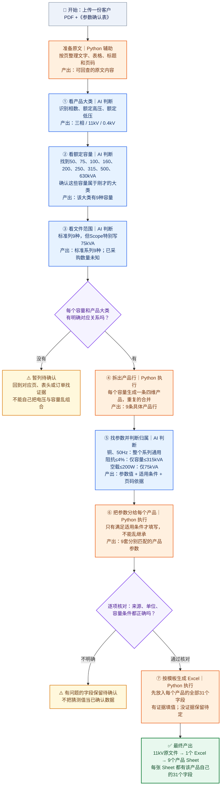

# 07｜我怎样把一份规格书拆成产品系列、产品行和逐产品参数（详细思路版）


## 先看总流程图｜从 PDF 到每个产品独立 Sheet

> **看图顺序：从上往下。蓝色框是 AI 负责“读懂和判断”，橙色框是 Python 负责“整理和执行”，黄色框表示有疑问要回原文核对。**  
> 每个方框最后一行的“产出”，就是这一步交给下一步的东西。**这张图表示推荐的自动化处理方式；目前仓库是解析思路文档，并不代表全部自动解析代码已完成。**



### 把这张图缩成最容易理解的一句话

**AI 先看懂“有哪些产品、每项参数给谁用” → Python 把产品拆成行、按条件分参数 → 核对后生成每产品独立 Sheet 的 Excel。**

| 你想知道的事 | 图里在哪里 | 11kV PDF 的例子 |
|---|---|---|
| **有几个产品大类？** | ① | 三相 / 11kV / 0.4kV，**1个大类** |
| **为什么是9个产品？** | ②③④ | §5.5.1有9种容量；按**技术标准全系列**拆9行，并非已采购9种 |
| **200W为什么只给75kVA？** | ⑤⑥ | AI判断原文只适用75kVA；Python匹配时不会分给500kVA |
| **最后为什么是9个Sheet？** | ⑦ | 9条产品行 → 9张Sheet；每张包含模板全部31个字段 |

**碰到第二份22kV PDF，就按同样流程另做一遍：**它自己识别出三相 / 22kV / 0.4kV、9种标准容量，单独生成另一个Excel。**不能直接复制11kV文件的证据来补22kV参数。**

> **最关键的不是“AI提取出200W”，而是“AI能说清200W只适用于75kVA”。** 这条判断一旦成立，Python才能安全地把它填进正确的产品。

---


> **本文只解释业务识别思路，不是数据库、接口或程序设计文档。**  
> 要回答的是：一份几十页的 PDF，为什么会被拆成多个产品？每一项参数为什么属于某些产品、却不属于另一些？**每一步具体识别什么、输出什么、靠什么判断正确？**  
> 贯穿案例：EDM《Attachment 1.1-Transformers 3P 11kV-备注版.pdf》和《Attachment 1.2 Transformers 3P 22KV-备注版.pdf》，以及这次有 **31 个字段**的《参数确认表》。页码为 PDF 物理页序，实际项目也应保留原文条款号和页码。  
> 现有配套文档：[08｜业务执行SOP](08-按解析思路落地_业务执行SOP.md) · [09｜EDM双文件演练](09-EDM双文件_业务拆解演练与验收样例.md)。


---

## 先看这里｜不用懂技术，也能理解的“五步版”

> **一句话：先列出这份 PDF 里有哪几种变压器，再从全文给每种变压器找属于自己的参数，最后才放进 Excel。**
>
> 可以把它想成整理商品：**先列商品清单，再给每件商品贴上它自己的参数标签**。不是先找数字就随便往表里填。

### 第一步：先看“这是哪一类变压器？”

**我看哪里？** 先读标题、Scope，再读电气参数章节核对。

**我只识别三个东西**：①单相/三相；②额定高压；③额定低压。

拿你的11kV PDF举例：

| 我问的是什么 | 原文告诉我的 | 我的判断 |
|---|---|---|
| 是单相还是三相？ | Three-phase | 三相 |
| 额定高压是多少？ | 11kV | 11kV |
| 额定低压是多少？ | 400/230V | 三相线电压是400V，所以按0.4kV识别一个低压等级 |

**第1步产出：一张「产品大类卡」**

```text
来源：11kV PDF
产品大类：三相 / 11kV / 0.4kV
当前产品大类数：1
目前还不知道包含几种容量。
```

**为什么不是更多大类？** `400/230V`在这份三相四线制文件中是线电压和相电压，不代表两个独立产品；`Um=12kV`是设备最高电压，不是新的12kV额定高压。

**验收问题**：能否用原文证明这三个属性？如果不能，先标待确认，不要继续随意扩出产品。

### 第二步：再找“这一类变压器有多少种容量？”

**我看哪里？** 找 Rated kVA、额定容量列表、容量表、技术附录。

**我只识别一个东西**：每个大类下面明确有哪些额定容量。

11kV PDF 第12页 §5.5.1 写出：

`50、75、100、160、200、250、315、500、630 kVA`

这9种容量在该文档的三相11kV/0.4kV系列里有对应关系，因此每个容量可以拆成一条**具体产品规格**。

**第2步产出：一张「产品清单」**

| 产品行 | 产品大类 | 容量 |
|---|---|---|
| 1 | 三相/11kV/0.4kV | 50kVA |
| 2 | 三相/11kV/0.4kV | 75kVA |
| 3 | 三相/11kV/0.4kV | 100kVA |
| 4 | 三相/11kV/0.4kV | 160kVA |
| 5 | 三相/11kV/0.4kV | 200kVA |
| 6 | 三相/11kV/0.4kV | 250kVA |
| 7 | 三相/11kV/0.4kV | 315kVA |
| 8 | 三相/11kV/0.4kV | 500kVA |
| 9 | 三相/11kV/0.4kV | 630kVA |

**本阶段结论：一个大类，9个技术容量规格。**

**必须强调**：第5页 Scope 特别写75kVA，但第12页标准系列列9个容量。这说明**标准列举了9个规格，而不是能证明本次采购9个型号**；若要知道本次真正买哪几种，还得看RFQ/订单。当前9行是用户选定的“标准系列全展开”口径。

**验收问题**：每一个容量是否真的属于这个电压和相数？如果新客户文件把多种电压、容量分别列在不同段落但没给配对关系，不能随便组合出产品。

### 第三步：全文找参数，但先问“这是给哪个产品用的？”

**我看哪里？** 查看阻抗、损耗、绕组、频率、附录技术数据等章节。

**我不是只找参数值，而是同时找它的适用范围。**

例如我在11kV PDF中读到：

| 我找到的要求 | 我理解“谁可以用” |
|---|---|
| 铜绕组 | 这个系列的各容量都可以用 |
| 50Hz | 这个系列的各容量都可以用 |
| 315kVA及以下阻抗≤4% | 只给50、75、100、160、200、250、315kVA |
| 500kVA阻抗≤5.5% | 只给500kVA |
| 630kVA阻抗≤6% | 只给630kVA |
| 75kVA空载≤200W | **只给75kVA** |
| 75kVA负载≤910W | **只给75kVA** |

**第3步产出：一张「参数归属表」**

```text
参数：阻抗
原文要求：不超过4%
适用范围：315kVA及以下
来源：第12页 §5.8.1

参数：空载损耗
原文要求：200W（规范最大值）
适用范围：仅75kVA
来源：第12页损耗表
```

**验收问题**：当有人问“200W为什么不能给500kVA？”能否明确回答：“因为原文表头限定了75kVA。”如果只知道数值、不知道给谁用，说明这一步还没理解对。

### 第四步：拿着9条产品清单，逐条填写各自参数

**我怎么做？** 从第2步任选一条产品，拿第3步的参数归属表逐个核对：**适用于它，才填写；不适用于它，就不能继承。**

例如：

| 参数 | 75kVA | 500kVA | 630kVA |
|---|---|---|---|
| 材质 | 铜 | 铜 | 铜 |
| 频率 | 50Hz | 50Hz | 50Hz |
| 阻抗上限 | ≤4% | ≤5.5% | ≤6% |
| 空载损耗 | ≤200W | 待定 | 待定 |
| 负载损耗 | ≤910W | 待定 | 待定 |

**第4步产出：「每个产品自己的参数内容」**。

例如500kVA：

```text
产品：三相 / 11kV / 0.4kV / 500kVA
材质：铜（系列通用）
频率：50Hz（系列通用）
阻抗：≤5.5%（专属于500kVA这一档）
空载损耗：待定（200W只属于75kVA）
负载损耗：待定（910W只属于75kVA）
```

**验收问题**：每个已经填写的参数，能否解释“为什么这个产品可以用”？不知道原因时，先当作待核对，而不是默认复制。

### 第五步：最后才按《参数确认表》生成一个产品一个Sheet

这时才打开客户提供的《参数确认表》，把**全部31个字段**作为每个产品共同的**空白表格框架**。

我的动作只有三件：
1. 每个产品都保留31个字段，顺序和单位跟模板一致；
2. 将第4步属于**这个产品**的参数填进去，没有明确数值就写“未提供/待供应商提供/待定”；
3. 按约定的八段名称拼成产品名称，并为这一条产品生成单独Sheet。

**第5步产出：「一个客户文件一个Excel，一个具体产品一个Sheet」**

```text
11kV PDF
  → 11kV产品参数.xlsx
      ├─ 50kVA   （自己的31个参数字段）
      ├─ 75kVA   （自己的31个参数字段）
      ├─ 100kVA  （自己的31个参数字段）
      ├─ 160kVA  （自己的31个参数字段）
      ├─ 200kVA  （自己的31个参数字段）
      ├─ 250kVA  （自己的31个参数字段）
      ├─ 315kVA  （自己的31个参数字段）
      ├─ 500kVA  （自己的31个参数字段）
      └─ 630kVA  （自己的31个参数字段）
```

22kV文件需要**独立重复这些步骤**，另外得到一个9-Sheet的Excel。两个PDF合计18个**技术系列规格**、2个大类；不能直接说“采购18个型号”。

**验收问题**：每个Sheet的31个字段是否齐全？有没有把75kVA的损耗填到500kVA？有没有把别的PDF里的参数复制过来？

### 把上面五步缩成一张最直白的交接表

| 步骤 | 只识别什么 | 这一步之后实际拿到什么 | 错了会有什么后果 |
|---|---|---|---|
| 1 看产品大类 | 单/三相、高压、低压 | **产品大类表** | 将12kV Um识别成新产品 |
| 2 看容量 | 每个大类有哪些kVA容量 | **具体产品清单（9行）** | 多出/漏掉产品 |
| 3 找参数归属 | 参数值和“它是给谁用的” | **参数适用范围表** | 把200W写给500kVA |
| 4 分给每个产品 | 这一条产品能匹配哪些要求 | **逐产品参数数据** | 不同容量参数乱套 |
| 5 输出Excel | 模板31字段与最终产品名 | **9张产品Sheet** | Sheet字段不全或产品混在一起 |

> **最难的是第3步：识别一句要求适用于“整个系列、部分容量还是单独一种容量”。** 一旦弄懂这个，第四步只是逐项核对，第五步只是按固定格式整理表格。
>
> 继续向下读，是同一套思路的**详细版**（阶段0～11），适合需要检查复杂客户PDF时阅读。


---

## 再看这里｜**从“识别什么”到“产出什么”，中间到底是怎么做到的？**

你最关心的问题应该是：**“AI是听懂了我的提示词，还是Python写了规则？到底每一步是谁在干？”**

### 先把事实讲清楚：**之前我实际怎么做的**，与**以后软件怎么自动做**，不是完全一回事

| 处理动作 | 前面两份EDM PDF我实际采用的方式 | 以后要稳定自动化，建议谁负责 |
|---|---|---|
| 阅读并理解PDF中的英文技术要求 | **ChatGPT对源文档进行理解和判断**，结合用户提出的“四维产品定义”和禁止乱填规则；核对章节/表格 | **AI阅读和理解**（Python可协助提取页面文字、表格、批注） |
| 得到11kV、0.4kV、三相的大类 | 依据标题、§5.3/§5.4解释额定电压/线相电压 | **AI提出候选**，再由固定规则核验 |
| 从§5.5.1的9个容量形成产品清单 | 先判断这些容量确实属于该系列，再按四维产品定义逐容量展开 | **AI理解“属于谁”**，**Python负责展开、去重、计数** |
| 判断75kVA损耗和阻抗分档 | 从原文理解“只针对75”或“≤315、500、630”的限定范围 | **AI提炼有条件的参数规则**，**Python负责计算是否适用** |
| 给每个产品整理31项参数 | 基于已理解的原文和归属条件整理，未知保持待定 | **AI找候选值**，**Python按模板字段逐产品填充和校验** |
| 输出每个产品一张Sheet的Excel | 使用结构化结果及Excel生成脚本；本次已验证工作簿、Sheet和字段 | **Python负责固定格式的Excel生成** |

**重要：之前并没有一段已经写好、能够独立读懂任何变压器PDF并自动拆出所有产品的Python程序。**

你下载过的 Skill 是**指导AI工作的一套规则说明**，不是运行后就自动懂所有规格书的“识别引擎”。Skill 包中的 `scripts/generate_excel.py` 是把**已核对好的 JSON**渲染成 Excel，脚本开头也说明了它**不会自己读取/理解PDF**。这就是我不建议只把提示词复制进后端、直接相信结果的原因。

### 两种工具最简单的分工

- **AI（提示词约束）**：负责读懂自然语言，例如判断“up to 315kVA”是“315及以下”，以及“200W”属于75kVA。
- **Python（确定性规则）**：负责已经有明确答案后的机械工作，例如对每个容量判断`<=315`、去重、填31行字段、生成9张Sheet。
- **人工复核**：原文模糊、文件正文与批注冲突、缺采购订单时，必须有人确认；**不是让AI或Python猜**。

### 例子一：从PDF一句英文，到9个产品行，中间做了哪几件事？

**PDF原文（第12页§5.5.1）**：三相变压器额定容量为50、75、100、160、200、250、315、500、630kVA。

我实际上经历了以下判断：

| 小动作 | 谁擅长完成 | 做了什么 | 得到什么 |
|---|---|---|---|
| ① 找到这段话 | 文本检索/Python辅助，AI检查上下文 | 在“Rated kVA”章节找到完整句子 | 一段带来源的原文 |
| ② 读懂它讲的是什么 | **AI** | 判断它描述的是当前**三相额定容量**，而非重量或短路参数 | `phase=3P`，9个`capacity_kva` |
| ③ 与电压大类对应 | **AI判断+规则核对** | 确认它属于当前11kV/0.4kV系列；若多个电压没说清归属就停止 | 大类`3P/11/0.4`与9种容量的关系 |
| ④ 逐容量生成产品行 | **Python** | 对9个容量分别增加同一大类的身份 | 9条四维产品行 |
| ⑤ 检查是否重复 | **Python** | 同四维键只留1行，保留所有出现位置 | 最终9条、不是18条重复行 |

**AI不需要逐条“编造”9行：只需要证明容量列表属于哪个大类。Python负责把这件事展开。**

**给AI的约束可以这么说（提示词示例）：**

```text
只从当前PDF提取相数、额定高压、额定低压和额定容量。
找到容量列表后，说明它归属哪个相数/电压系列，
并提供原文页码与条款。不得把设备最高电压Um当额定电压。
如果多个系列与容量的对应关系不清楚，必须返回待确认，
不允许将电压列表与容量列表随意相乘。
```

**Python拿到的中间结果应该类似这样（不是PDF直接给出的JSON，而是AI整理后的候选数据）：**

```json
{
  "source": "11kV.pdf",
  "phase": "三相",
  "hv_kv": 11,
  "lv_line_kv": 0.4,
  "capacities_kva": [50,75,100,160,200,250,315,500,630],
  "evidence": "第12页 §5.5.1",
  "scope": "技术标准全系列"
}
```

之后Python根据这个已核对的列表，逐个生成`三相+11kV+0.4kV+容量`，**不是让Python从英文里自己猜9个容量。**

### 例子二：从“≤315kVA阻抗≤4%”，到“75kVA填4%、500kVA不填4%”

这是你最应该掌握的关键环节。

**PDF原文**：不超过315kVA的规格，其阻抗不超过4%。

**AI先做的事：把一句英文“翻译”为一条能判断的规则，而不仅提取数字4。**

```text
参数名称：阻抗
参数要求：≤4%
容量条件：≤315kVA
数值性质：规范上限，不是实测/保证恰好4%
原文依据：第12页 §5.8.1
```

**Python再做的事：只执行条件，不负责解释英语。**

```python
capacity_list = [50, 75, 100, 160, 200, 250, 315, 500, 630]

def impedance_limit(kva):
    if kva <= 315:
        return "≤4%"
    if kva == 500:
        return "≤5.5%"
    if kva == 630:
        return "≤6%"
    return "待确认"

for kva in capacity_list:
    print(kva, impedance_limit(kva))
```

**注意这段代码只是用EDM数据演示“条件怎样执行”，不能当作所有客户通用规则。** 下一份规格书可能写≤4.5%或另一个分界值，所以**具体规则必须来自下一份客户原文，不能写死在程序里**。

比较：
- 75≤315，所以75kVA匹配`≤4%`；
- 315≤315，所以315kVA也匹配`≤4%`；
- 500不满足≤315，但**另有500专属条件**，所以使用`≤5.5%`；
- 630另用`≤6%`。

这说明：**AI负责“发现并读懂条件”，Python负责“逐个产品判断条件是否成立”。**

### 例子三：为什么Python不能把75kVA的200W复制给500kVA？

**PDF原文损耗表**只给出75kVA的空载200W和负载910W。AI不该只返回`200W`，而应连同适用容量一起返回：

```text
空载损耗：≤200W
适用容量：仅75kVA
类型：规范最大值
来源：第12～13页损耗表

负载损耗：≤910W
适用容量：仅75kVA
类型：规范最大值
来源：第12～13页损耗表
```

Python只需要判断：

```python
def loss_limits(kva):
    # 演示：本段规则来自EDM 75kVA专属损耗表
    if kva == 75:
        return {"no_load_w": 200, "load_w": 910}
    return {"no_load_w": None, "load_w": None}  # 没有证据 → 待定
```

所以75kVA有200W和910W，而500kVA仍是待定。

**现实中不应该把这个75kVA判断写死在系统里**。应该由AI把这份客户的规则抽成数据，再由Python运行匹配；换另一份PDF，规则自然换成该PDF自己的内容。

### 例子四：最后31字段和9个Sheet，Python是怎么产出的？

只有到这一阶段，才拿客户提供的《参数确认表》。

Python需要按这样一个顺序工作：

```text
读取《参数确认表》全部字段（本次31个）
           ↓
拿出11kV这份PDF识别出的9条产品
           ↓
为第1个产品建一张新的Sheet，复制31个字段
           ↓
逐个字段读取该产品“已经匹配好的参数值”
           ↓
有值：写原文值+来源；没值：保留字段，写待定
           ↓
再处理第2个产品……直到9个产品完成
           ↓
重新检查Sheet是否恰好9张、每张是否恰好31字段
```

这里AI不需要控制Excel长什么样。**Python执行固定的格式，才不会忽然把9个产品放进同一个Sheet。**

### 你可以直接用来复盘的“每一步谁做什么”

| 步骤 | 原始输入 | **AI/提示词真正做的动作** | **Python真正做的动作** | 产出 |
|---|---|---|---|---|
| 1 识别大类 | PDF标题、Scope、电压章节 | 识别三相/额定11kV/400-230V，解释为什么低压按0.4kV | 统一单位、核查缺项与重复 | 1个产品大类 |
| 2 识别容量 | PDF额定容量章节 | 提取9个额定容量并判断归属11kV系列 | 逐容量展开、按四维去重 | 9个产品行 |
| 3 识别参数归属 | PDF损耗、阻抗、绕组等章节 | 提取参数+数值+性质+适用条件+证据 | 保存条件并检查能否执行 | 通用/分档/专属参数规则 |
| 4 逐产品填参 | 上步规则+9个产品行 | 对有歧义的来源辅助判断 | 对每个产品判断规则是否适用，生成各自字段值 | 9套独立参数内容 |
| 5 生成Excel | 9套参数+模板31字段 | 不负责机械输出格式 | 每产品新建Sheet，填全部字段，检查数量/顺序 | 1个Excel、9个Sheet |

### 到底“提示词约束”起什么作用？

提示词是**告诉AI必须怎样阅读与判断**，例如：
- “先找相数、高低压，再找属于每个系列的容量”；
- “不能把Um识别成新的额定高压”；
- “200W只有原文注明的容量才能继承”；
- “不知道就写待定，必须给页码”。

**但提示词只能约束AI的输出行为，不能保证100%正确。** 它可能仍会认错表头、漏容量或给出错误的来源，所以每一步的中间结果还必须经过规则和原文复核。

### 到底“Python代码”起什么作用？

Python只负责它**可以确定地做对的工作**：
- 提取PDF页面文字/表格候选以及Excel模板字段；
- 将明确的产品维度和容量列表展开为产品行并去重；
- 运行容量条件（例如`<=315`、`==75`）以选择适用参数；
- 保证每个产品都有完整模板字段；
- 格式化名称、生成逐产品Sheet Excel和数量校验。

Python若没有已经明确的“200W只属于75kVA”这条规则，**单靠它看到200这个数字，也不能安全判断给谁填**。

### 你现在要形成的最终认识

```text
客户PDF
  ↓（Python辅助读取文字；AI读懂语义）
AI：这份文件有哪类变压器？哪些容量属于它？
  ↓（结构化候选，带原文依据）
Python：把明确组合展开、去重 → 产品行
  ↓
AI：这条参数适用于整个系列、部分容量还是单一容量？
  ↓（每条要求必须有值+适用条件+数值性质+证据）
Python：逐条匹配到产品 → 形成逐产品参数
  ↓
Python：按参数模板生成Excel → 每产品一个Sheet
  ↓
人工/规则检查：与原文一致吗？漏了产品或误继承了吗？
```

**真正可落地的组合是“AI理解原文 + Python执行规则 + 原文证据及人工复核”，而不是“只靠一段大提示词”或“把11kV的9种容量写死进Python”。**

> **文档定位**：这一节解释“识别到产出中间实际怎么做”，下方仍保留完整的**阶段0～11业务思路**，供你需要细化某个判断时继续查阅。

---

## 一、先理解我的“脑内模型”：不是先填字段，而是先拼结构

拿到规格书时，我没有直接问“31个字段的答案是什么？”。我先将正文看作四类不同信息：

| 我看到的信息 | 我要理解的问题 | 它最终决定什么 | EDM例子 |
|---|---|---|---|
| **身份信息** | 这是什么相数、额定高压、额定低压的变压器？ | **产品大类** | 三相 / 11kV / 0.4kV |
| **容量信息** | 该产品大类明确包括哪些额定容量？ | **具体产品行** | 50/75/100/160/200/250/315/500/630kVA |
| **范围信息** | 是标准支持的系列、Scope重点指定的型号，还是已确认采购？ | **数量统计口径与导出范围** | 标准列9档，Scope特别写75kVA |
| **条件信息** | 这个参数值是什么性质，适用于哪些产品？ | **每条产品行里的参数值** | ≤315kVA阻抗≤4%；75kVA空载损耗≤200W |

因此，**产品身份的判断**和**参数归属的判断**必须分开。

- 一条具体产品行的识别维度固定为：**相数 + 额定高压 + 额定低压 + 额定容量**。
- **材质、损耗、阻抗、频率是这条产品的属性**。在现行四维规则下，它们的值不同并不会自动新增产品行。
- 《参数确认表》只规定“每条产品要输出哪些参数字段”，**它本身不能证明客户有几种产品**。
- 标准中列出9种容量，表示可以在“全标准系列”口径下展开9条规格，**不能证明已采购9款，更不代表9台**。

### 从思路到结果的完整链路

```text
阶段0：确定文件角色与统计口径
         ↓
阶段1：阅读定位，给原文建立证据目录
         ↓
阶段2：识别相数、额定高压、额定低压 → 产品大类
         ↓
阶段3：识别额定容量及其归属 → 大类—容量关系
         ↓
阶段4：理解Scope/附录/订单 → 标准系列与实际指定分开
         ↓
阶段5：只展开有证据的四维组合 → 一行一个具体产品
         ↓
阶段6：扫描全文参数 → 原文技术要求候选
         ↓
阶段7：理解每条参数的性质与适用条件 → 参数归属规则
         ↓
阶段8：用规则匹配每个产品 → 逐产品参数关联结果
         ↓
阶段9：套入《参数确认表》 → 每产品完整字段及缺失标记
         ↓
阶段10：从产品反向检查原文 → 错漏、冲突、差异清单
         ↓
阶段11：命名、统计、导出 → 一文件一Excel／一产品一Sheet
```

**每个阶段都必须有独立的中间产物。** 如果产品数量算错了，应该能判断是“相数/电压认错”“容量归属错”“Scope口径错”还是“四维重复展开”，而不是等Excel出来才发现不对。

---

## 二、阶段总览：到底识别什么，产出什么？

| 阶段 | 本阶段只回答什么 | 应去看哪些原文 | 必须产出的中间结果 | 能否继续的关键检查 |
|---|---|---|---|---|
| **0 文件与口径** | 哪些是客户规格书、哪些是订单/澄清？按什么口径统计？ | 文件名、客户、关联文件、任务要求 | **A. 文件角色与统计口径卡** | 源文件独立；不把标准数量说成采购 |
| **1 阅读定位** | 重要事实藏在哪些页和表？ | 封面、Scope、Requirements、Losses、Annex、批注 | **B. 文档证据导航表** | 能回到具体原文 |
| **2 产品大类** | 相数、额定高低压各是什么？ | 标题、§5.3、§5.4等 | **C. 产品大类候选表** | 不把Um/分接/相电压当独立型号 |
| **3 容量归属** | 有哪些额定容量？分别属于哪个大类？ | Rated kVA、Ratings、容量表 | **D. 大类—容量关系表** | 组合关系有证据，未乱相乘 |
| **4 范围判断** | 标准全系列还是本次明确规格/采购？ | Scope、GTP、RFQ、PO、正式澄清 | **E. 规格范围声明表** | 区分标准、指定、已采购 |
| **5 生成产品行** | 最终候选有几种四维产品？ | C+D+E及其原文依据 | **F. 具体产品行清单** | 一行一个产品，四维去重，标识来源 |
| **6 参数召回** | 全文出现了哪些与参数相关的要求？ | §5～§19、表格、附录、批注 | **G. 参数原文摘录表** | 不因只看一页而漏正文/附录 |
| **7 参数理解** | 每条要求含什么值、适用于谁、是什么性质？ | G中的证据全文及表头注脚 | **H. 参数适用规则表** | 200W属于75kVA，+10%是允差 |
| **8 匹配产品** | H里的规则分别能写给F里的哪些产品？ | F的产品身份 + H的适用范围 | **I. 产品—参数归属表** | 不错误继承、不跨PDF混值 |
| **9 模板对齐** | 每条产品的全部模板字段填什么？ | 《参数确认表》+ I | **J. 单产品完整字段表** | 31个字段均在，缺失不删除 |
| **10 反向核验** | 有没有漏产品、错范围、错值或冲突？ | 每条产品及每个已写值的原文 | **K. 核验与待确认问题表** | 阻断性问题未解决不宣称确认 |
| **11 命名导出** | 如何形成产品名称、Sheet和总统计？ | F、J、K及确认口径 | **L. Excel和统计结果** | 文件数/Sheet数/字段数准确 |

接下来每个阶段按照 **识别对象 → 判断动作 → 中间产物 → EDM实际例子 → 通过标准/不确定如何处理** 展开。

---

## 三、阶段0：先搞清“这些文件是什么”和“我要按什么范围算”

### 0.1 识别什么

不是识别变压器参数，而是识别**资料的角色和业务目的**：

- 哪份是客户技术标准或规格书？哪些是参数模板？
- 哪份是 RFQ（询价范围）、PO（采购订单）、正式澄清、批注版？
- 是要求识别技术标准**所有容量**，还是仅识别本次明确产品，还是核对**已经确认采购**的型号？
- 一次传入多份规格书，是否都要各自产出Excel？答案在本任务是**是**。

### 0.2 我的判断动作

先为每份客户规格书划一道独立边界：**11kV PDF里的数据只用于11kV PDF对应的产品；22kV PDF必须从自身原文核对**。关联的RFQ/澄清可以作为外部依据，但要保留独立来源，不能假装是原PDF正文。

### 0.3 产出A｜文件角色与统计口径卡

| 文件 | 文件角色 | 客户/来源 | 当前选用统计口径 | 与其他文件关系 |
|---|---|---|---|---|
| Attachment 1.1（11kV） | 客户技术规格书 | EDM | 标准全系列 | 独立解析、独立导出 |
| Attachment 1.2（22kV） | 客户技术规格书 | EDM | 标准全系列 | 独立解析、独立导出 |
| 参数确认表 | 参数输出模板 | 用户提供 | 不参与产品数量判断 | 给每个产品提供字段列表 |
| RFQ/PO（本次未提供） | 采购范围依据 | 待获取 | 无法确认采购型号/台数 | 以后如有需明确关联 |

### 0.4 本阶段怎么验收

必须能用一句话说明：“本次按技术标准**列出的容量系列**识别，不等于实际采购量；两份PDF要分别输出。”  
**过不了关时**：先把导出范围标为“待选”；不要默认所有规格都已采购。

---

## 四、阶段1：我先把PDF读成一张“事实地图”，而不是通篇提取数字

### 1.1 识别什么

我会在整份文件中找出事实**出现的位置**及角色：

- 标题、Foreword、Scope：主要设备与项目范围；
- Electrical System Parameters、Voltage Ratio：额定相数、电压、频率；
- Rated kVA：容量集合；
- Transformer Impedance、Losses：容量条件参数；
- Windings、Core、Cooling、Installation等：通用技术要求；
- Annex A/GTP、技术数据表、脚注和中文批注：单规格明细、供应商待报、潜在修改。

### 1.2 我的判断动作

遇到一个数值，**先不急着判断它属于哪条产品**，而是记录“原文在哪”“它大致回答什么问题”。例如：第12页看到 50、75、100……，先标为“额定容量线索”；看到 200W，先标为“损耗限值线索”，不提前分给9个产品。

### 1.3 产出B｜文档证据导航表（节选）

| 文件 | 位置 | 原文给出的信息 | 事实分类 | 下一阶段用在哪里 |
|---|---|---|---|---|
| 11kV PDF | 第5页 Scope | 三相11kV/400-230V、特别提75kVA | 身份、范围 | 2、4 |
| 11kV PDF | 第11页 §5.3 | 三相11kV、400/230V、50Hz | 身份、通用参数 | 2、7 |
| 11kV PDF | 第12页 §5.5.1 | 9个额定容量 | 容量枚举 | 3 |
| 11kV PDF | 第12页 §5.8.1 | 阻抗按容量区间 | 分档参数 | 7 |
| 11kV PDF | 第12～13页 §6 | 75kVA空载200W、负载910W | 专属损耗 | 7 |
| 11kV PDF | 第24～26页 Annex A | 75kVA GTP及供应商需填报项目 | 专属规格、待提供 | 4、7、9 |
| 22kV PDF | 自身第11～13、24～26页 | 22kV额定电压、容量、阻抗及损耗/GTP | 相同类别，但来源不同 | 单独建立导航 |

### 1.4 本阶段怎么验收

别人问“9个容量在哪里？”能回答**第12页 §5.5.1**；问“200W为什么属于75kVA？”能找到**第12～13页的表**。  
**过不了关时**：标出“证据尚未定位”，继续检查跨页表格或原文图像，不因为没识别到就填写常见值。

---

## 五、阶段2：识别产品大类——只看相数、额定高压、额定低压

### 2.1 识别什么

产品大类的三个维度：

| 识别项 | 我要认的是什么 | 不能当成它的内容 |
|---|---|---|
| 相数 | Single phase/Three-phase等明确相数 | “三相四线制”中的“四线”不是四相 |
| 高压等级 | 额定一次电压 Nominal Primary Voltage | 设备最高电压Um、绝缘耐压、分接档位 |
| 低压等级 | 额定二次电压及其线/相电压关系 | 把三相400/230V误拆成两款 |

### 2.2 我的判断动作

封面只给**候选**，再找正文的系统参数和变比确认。EDM 11kV文件：三相、一次11kV、二次400/230V；对该三相系统，**400V是线电压、230V是相电压**，所以按本次约定以0.4kV作为低压产品分类值。

另外，11kV文件出现`Um=12kV`，22kV文件出现`Um=24kV`。它们是设备最高电压，**不能再增加12kV或24kV额定高压产品系列**。

### 2.3 产出C｜产品大类候选表

| 大类编号 | 源文件 | 相数 | 额定高压 | 额定低压 | 原文表示 | 识别依据 | 结论 |
|---|---|---|---|---|---|---|---|
| C11 | 11kV PDF | 3P | 11kV | 0.4kV | 400/230V | 标题、§5.3、§5.4 | 1个大类 |
| C22 | 22kV PDF | 3P | 22kV | 0.4kV | 400/230V | 标题、§5.3、§5.4 | 1个大类 |

**阶段产出数量：2个大类（分别属于各自原文），但暂时不确定具体产品规格数。**

### 2.4 本阶段怎么验收／何时停下来

- 不出现“11kV大类 + 12kV大类”或者“22kV + 24kV”。
- 不因为400/230V生成0.4kV和0.23kV两个低压产品。
- **如原文确实规定了两种独立二次输出额定值**，就进一步判定是否存在两个大类；不能把EDM的具体理解强套到所有客户文件。
- 相数或额定电压没明确证据时，保留候选并标“待确认”，不能凑一个大类。

---

## 六、阶段3：识别容量——最关键的是“属于哪个大类”

### 3.1 识别什么

容量必须是**额定容量 kVA**。我要提取：

1. 看到哪些数值（50、75、100……）？
2. 单位是否为kVA，是否讲额定容量（不是电流、短路容量、重量）？
3. 每个容量由哪句文字或哪个表头**归属到具体大类**？
4. 有无多个容量档、单/三相分组或不同电压专属容量？

### 3.2 我的判断动作

这两份PDF第12页 §5.5.1 都明确列出三相额定容量：

`50、75、100、160、200、250、315、500、630kVA`

在这两份**各自的三相额定电压系列上下文**中，能够建立“本大类包含9种标准容量”的关系。

注意这不是“看见两个列表就相乘”。如果一份陌生PDF只分别列出了“11kV、22kV”和“50、75kVA”，却没有说它们互相配对，**我不会自动生成4种产品**。

### 3.3 产出D｜大类—容量关系表

| 所属大类 | 额定容量清单 | 数量 | 容量归属的原文证据 | 关联结论 |
|---|---|---:|---|---|
| C11：3P/11kV/0.4kV | 50、75、100、160、200、250、315、500、630 | 9 | 11kV文件§5.5.1 | 可按标准系列展开 |
| C22：3P/22kV/0.4kV | 同样9个容量 | 9 | **22kV文件自身**§5.5.1 | 可按标准系列展开 |

### 3.4 本阶段怎么验收／何时停下来

- 能说清“哪句话说明这些容量属于这个系列”，而不是只报容量数字。
- 若一个容量同时在正文与附录出现，通常是同一规格的不同证据，**不会因为重复出现就增加产品**。
- 模板参考容量不包含160kVA时，也仍保留客户原文160kVA，等后面做差异标记。
- **没找到容量—电压的对应关系**：标为“关系不明”，不进入确定产品行集合。

---

## 七、阶段4：识别范围——“标准包含”不等于“明确采购”

### 4.1 识别什么

同一个容量可能同时属于几种不同语义：

- **STANDARD_SERIES：标准系列规格**——技术标准说这个系列涵盖它；
- **EXPLICIT_SPEC：文件明确指定规格**——Scope、特定GTP或专门技术表重点描述它；
- **ORDER_CONFIRMED：实际采购确认**——有足够的RFQ/PO等本次有效文件明确要求。

这三种含义**可以同时存在于同一规格上，不一定互斥**。

### 4.2 我的判断动作

EDM 11kV文件：
- §5.5.1列9个标准容量；
- 第5页Scope特别写75kVA；
- 第24页 Annex A GTP标题明确75kVA。

EDM 22kV文件：
- §5.5.1也列9个容量；
- Scope特别写75kVA；
- Annex A GTP容量位置为待填写的 `_____ kVA`。

所以不能把这两份文件都简单理解为“已经采购9种产品”。我们保留标准系列9种，同时标记哪些被Scope特别点名；订单尚未提供，采购型号/台数均未知。

### 4.3 产出E｜规格范围声明表（代表性样例）

| 文件 | 规格 | 标准系列 | Scope/专属表 | 订单确认 | 我的结论 |
|---|---|---|---|---|---|
| 11kV | 75kVA | 是 | Scope + Annex A点名 | 无可核实订单 | 属于标准系列，且被重点指定 |
| 11kV | 500kVA | 是 | 目前未见单独点名 | 无可核实订单 | 标准系列规格，不声称采购 |
| 22kV | 75kVA | 是 | Scope点名；GTP容量留空 | 无可核实订单 | 有明确Scope描述，采购未知 |
| 22kV | 630kVA | 是 | 目前未见单独点名 | 无可核实订单 | 标准系列规格，不声称采购 |

### 4.4 本阶段怎么验收／何时停下来

- 报“18个产品”时须注明：**2份PDF合计18个标准技术规格**。
- 本阶段没有RFQ/PO，不允许把“采购确认数”写成18。
- 若Scope、附件、正式澄清相互矛盾，保留冲突和双方依据，**不要自己决定采购清单**。
- 本次用户要求“所有容量独立Sheet”，选的是**标准全系列导出口径**；这是一种输出选择，不等于原文自动确认采购。

---

## 八、阶段5：展开“产品行”——什么时候才可以说有多少种产品

### 5.1 识别什么

到这里才把“产品大类 + 容量归属”转成真正的四维具体产品。

**唯一判断问题**：这一个“相数 + 额定高压 + 额定低压 + 容量”的组合，是否有原文证据支持？

产品分类规则：

- **同相数、同额定高低压，不同容量 → 不同具体产品行**。
- **不同相数或不同额定高低压 → 先分不同大类**。
- **同一四维规格多处出现 → 合并同一产品行，保留多条证据**。
- 材质、损耗、阻抗、频率不同，先视为同一四维规格的参数或方案差异，**不自行增加四维产品数量**；若业务以后要求把铜、铝报价方案作为独立品种，需要单独定义“产品变体”口径。

### 5.2 产出F｜具体产品行清单（以11kV为例）

| 行编号 | 相数 | 高压 | 低压 | 容量 | 所属大类 | 范围标签 |
|---|---|---|---|---|---|---|
| P11-050 | 3P | 11kV | 0.4kV | 50kVA | C11 | STANDARD_SERIES |
| P11-075 | 3P | 11kV | 0.4kV | 75kVA | C11 | STANDARD_SERIES + EXPLICIT_SPEC |
| P11-100 | 3P | 11kV | 0.4kV | 100kVA | C11 | STANDARD_SERIES |
| P11-160 | 3P | 11kV | 0.4kV | 160kVA | C11 | STANDARD_SERIES |
| P11-200 | 3P | 11kV | 0.4kV | 200kVA | C11 | STANDARD_SERIES |
| P11-250 | 3P | 11kV | 0.4kV | 250kVA | C11 | STANDARD_SERIES |
| P11-315 | 3P | 11kV | 0.4kV | 315kVA | C11 | STANDARD_SERIES |
| P11-500 | 3P | 11kV | 0.4kV | 500kVA | C11 | STANDARD_SERIES |
| P11-630 | 3P | 11kV | 0.4kV | 630kVA | C11 | STANDARD_SERIES |

22kV文件同样生成9条，但其原文、产品大类和行编号独立，**不能因容量相同就把两个文件合成一行**。

### 5.3 本阶段的明确产出数量

| 来源 | 产品大类数 | 标准系列具体产品行数 | 已确认采购数 |
|---|---:|---:|---|
| 11kV文件 | 1 | 9 | 未确认 |
| 22kV文件 | 1 | 9 | 未确认 |
| **合计** | **2** | **18** | **未确认** |

### 5.4 本阶段怎么验收

- 11kV产品行不会误用22kV的一次电压。
- 75kVA出现在文件3处证据，也仅有**一条**11kV/75kVA产品行。
- 没有任何无来源的“11kV + 新容量”组合。
- 产品行的生成**与31个参数字段无关**；即使某产品一个损耗都没有，也不能删掉它。

---

## 九、阶段6：第二次通读全文，这次专门“找参数候选”

### 6.1 识别什么

第一次读文档是确定“有什么产品”；**这一次才找“产品有什么技术要求”**。

我会按《参数确认表》的字段去全文查找，同时允许发现模板之外但产品命名必要的信息（例如空载损耗的W值），避免只找模板同名字而漏掉技术数值。

尤其查：
- 绕组、铁芯、材质、冷却方式；
- 电气参数、分接、阻抗、连接组别；
- 空载损耗、负载损耗、噪声；
- 尺寸重量、耐压/绝缘/套管、环境条件；
- GTP附录、供应商待填内容、中文批注。

### 6.2 我的判断动作

**找到一句话不等于现在就可以填进某个产品。**

比如 §5.8.1写多个阻抗值，此阶段先摘成三个候选；§6里找到200W、910W，也先摘出来，并带上表头“75kVA”。

### 6.3 产出G｜参数原文摘录表

| 候选编号 | 来源文件/位置 | 参数线索 | 原文数值/表达 | 重要上下文 |
|---|---|---|---|---|
| G01 | 11kV §5.3 | 频率 | 50Hz | 11kV三相系统 |
| G02 | 11kV §5.8.1 | 阻抗 | 4% | up to 315kVA |
| G03 | 11kV §5.8.1 | 阻抗 | 5.5% | for 500kVA |
| G04 | 11kV §5.8.1 | 阻抗 | 6% | for 630kVA |
| G05 | 11kV §6 Table 1 | 空载损耗 | 200W | 75kVA |
| G06 | 11kV §6 Table 1 | 负载损耗 | 910W | 75kVA |
| G07 | 11kV §6.2.2 | 损耗允许偏差 | +10% | Table 3.2 Tolerances |
| G08 | 11kV Annex A | 保证损耗 | Vendor to state | 各报价容量需单独填报 |
| G09 | 11kV §7.2 | 绕组材质 | Copper | 适用于该文档所述容量 |

### 6.4 本阶段怎么验收

- 不只看第12页容量列表或第13页损耗表，**也要看附录、脚注、批注**。
- 若全文未给其他容量的空载W值，此阶段不能凭经验生成。
- 同一数值出现在表格的不同列时，要保留列头/行头的对应关系。
- 该阶段输出是**原文候选**，下一阶段才确认它对谁有效、是什么语义。

---

## 十、阶段7：把原文翻译成“可判断适用范围的规则”

这是整套解析思路的**核心阶段**。我真正做的不只是抽数字，而是理解数字背后的限制条件。

### 7.1 每一条原文要求，我必须回答六个问题

| 问题 | 举例说明 |
|---|---|
| **是什么参数？** | 阻抗、空载损耗、负载损耗、频率、材质 |
| **值是什么？** | 4%、200W、50Hz、Copper |
| **数值是什么性质？** | 上限≤、下限≥、固定要求、测试允差、厂家保证/待提供 |
| **适用于谁？** | 全系列、容量≤315、仅500、仅75，必要时限定额定高压或相数 |
| **有没有例外？** | 500/630kVA有专门的阻抗上限 |
| **出处在哪？** | 哪份PDF、页码、章节、表格、批注；是否存在冲突 |

### 7.2 我将参数分成五种归属类型

| 归属类型 | 识别依据 | 我怎么处理 |
|---|---|---|
| **全系列通用** | 明确适用于本电压/相数系列，或原文写all ratings | 该系列所有受约束产品可继承 |
| **容量区间/分档** | up to、less than、above、范围端点等 | 只给符合区间的产品 |
| **单容量专属** | 某一行表头明确75kVA/500kVA | 只给该容量 |
| **厂家待提供/未找到** | Vendor to state、未列数值 | 不捏造，分别记待提供/未提供 |
| **冲突或不确定** | 正文与批注、脚注、附录的要求不同 | 保留双方及来源，列待确认 |

“分档”和“专属”都是**适用条件**；“上限/允差/保证”则是**值的性质**。二者是两个不同判断，不能合为一个标签。

### 7.3 产出H｜参数适用规则表（11kV示例）

| 规则编号 | 参数 | 完整技术含义 | 适用条件 | 归属类型 | 原文位置 |
|---|---|---|---|---|---|
| H01 | 绕组材质 | 铜绕组 | 当前系列各容量 | 全系列通用 | §7.2 / Annex A |
| H02 | 额定频率 | 50Hz | 当前系列各容量 | 全系列通用 | §5.3 |
| H03 | 阻抗 | **≤4%**，规范上限 | 额定容量≤315kVA | 容量分档 | §5.8.1 |
| H04 | 阻抗 | **≤5.5%**，规范上限 | 额定容量=500kVA | 单容量专属 | §5.8.1 |
| H05 | 阻抗 | **≤6%**，规范上限 | 额定容量=630kVA | 单容量专属 | §5.8.1 |
| H06 | 空载损耗 | **≤200W**，规范最大值 | 额定容量=75kVA | 单容量专属 | §6 Table 1 / Table 3.1 |
| H07 | 负载损耗 | **≤910W**，规范最大值 | 额定容量=75kVA | 单容量专属 | §6 Table 1 / Table 3.1 |
| H08 | 损耗测试允差 | +10%（其适用要求按原文表） | 测试/验收场景 | 允差语义 | §6.2 Table 3.2 |
| H09 | 厂家保证损耗 | 由供应商按报价额定容量提供 | 各报价容量 | 待供应商提供 | Annex A |

**对22kV文件必须建立自己的H表**，数值可能恰好相同，但证据和适用对象不能借用11kV文件。

### 7.4 为什么我不会混淆三个常见数值

| 看见数字 | 实际是什么 | 绝不能误写成 |
|---|---|---|
| 200W | 75kVA空载损耗的规范最大值 | 所有容量的空载损耗、厂家实测200W |
| +10% | 损耗验收/测试允差 | 空载损耗10W |
| ≤4% | 315kVA及以下阻抗上限 | 保证实测恰好4%或500kVA阻抗 |

### 7.5 本阶段怎么验收／何时停下来

- 问“200W适用哪些容量？”必须能说**仅75kVA**，而不是“我在同一文档里看见它”。
- 问“500kVA阻抗多少？”必须能说**上限≤5.5%**，并能解释为什么不使用≤315kVA的4%。
- 一句话如果无法判断作用范围，先记为“适用范围待核对”，**不能默认全系列通用**。
- 参数来源有中文备注或正式澄清时，区分是“意见”还是“生效要求”；未确认不能默默覆盖正文。

---

## 十一、阶段8：拿着产品行，让每条参数规则逐个“对号入座”

### 8.1 识别什么

这里不再找新产品，也不再无目的找数字。我要判断的是：

> **H表中的这条规则，能否作用于F表中的这一个具体产品？**

对一条产品逐个问：
- 这条规则属于本源文件、本产品所属相数/额定电压吗？
- 容量条件是否覆盖该产品？
- 它是通用规则还是某一容量专用规则？
- 同一字段有多个符合条件、但数值互相矛盾的规则吗？
- 没有找到针对这款的数值，是“待供应商报”，还是“原文未提供”？

### 8.2 我如何判定：示例500kVA

```text
当前产品：P11-500 = 3P / 11kV / 0.4kV / 500kVA
H01 铜：整个11kV系列适用                 → 匹配，铜
H02 50Hz：整个11kV系列适用                → 匹配，50Hz
H03 阻抗≤4%：需要容量≤315kVA             → 不匹配，不能填4%
H04 阻抗≤5.5%：要求容量=500kVA            → 匹配，≤5.5%
H05 阻抗≤6%：要求容量=630kVA              → 不匹配
H06 空载≤200W：要求容量=75kVA             → 不匹配，空载W待定
H07 负载≤910W：要求容量=75kVA             → 不匹配，负载W待定
```

### 8.3 产出I｜产品—参数归属矩阵（节选）

| 产品 | 材质 | 频率 | 阻抗上限 | 空载损耗W | 负载损耗W | 为什么是这个结果 |
|---|---|---|---|---|---|---|
| 11kV/50kVA | 铜 | 50Hz | ≤4% | 待定 | 待定 | 通用+≤315分档，无本容量损耗 |
| 11kV/**75kVA** | 铜 | 50Hz | **≤4%** | **≤200W** | **≤910W** | 通用+≤315+75专属 |
| 11kV/315kVA | 铜 | 50Hz | ≤4% | 待定 | 待定 | 315在≤315范围内 |
| 11kV/**500kVA** | 铜 | 50Hz | **≤5.5%** | 待定 | 待定 | 500专属阻抗，不继承75损耗 |
| 11kV/**630kVA** | 铜 | 50Hz | **≤6%** | 待定 | 待定 | 630专属阻抗，不继承75损耗 |
| 22kV/75kVA | 铜 | 50Hz | ≤4% | ≤200W | ≤910W | **来自22kV原文自身对应规则** |

矩阵只是显示关键字段的**示意截面**；实际每个产品还要匹配模板规定的其他字段。

### 8.4 本阶段怎么验收

- **每一个写入值都能反查：产品行 → 适用规则 → 原文证据**。
- 不同文档不混用。11kV和22kV即使都有75kVA/200W，也必须分别来源于自身PDF。
- 一个容量段的边界值要核实包含关系：315kVA属于“up to315kVA”，500kVA不属于。
- 规则匹配完仍无值，应**保留待定**；不能因为类似容量有值就进行插值或猜测。

---

## 十二、阶段9：最后才拿《参数确认表》，将每款产品展开成完整字段

### 9.1 识别什么

这里的目标不再是“有多少产品”，而是**每个产品需要输出哪些字段**。我对模板只问：

- 字段名称、分类、单位、顺序分别是什么？
- 模板里是否有某些参考值或标准容量？
- 客户原文找到的是同一个参数概念吗？
- 该产品的该字段是有明确值、待供应商提供、未提供、不适用还是有冲突？

**模板字段永远不因为源PDF没提到就删除。** 当前样本有31个字段，未来换模板就按新模板动态确定。

### 9.2 我的填写步骤

1. 为每条产品建立**31个字段的空框架**，复制原模板字段名、单位、顺序。
2. 从I表逐字段找已匹配的要求，按正确语义填进去。
3. 找不到则标“未提供”；原文要求Vendor to state则标“待供应商提供”；明确不适用才标“不适用”；有多处冲突则保留冲突。
4. 损耗**W数值**与测试允差**%**即使都涉及空载/负载，也不得填错字段类型。
5. 本次客户容量160kVA与模板参考容量系列不同，要**保留客户实际规格，同时标记差异**。

### 9.3 产出J｜单产品完整字段表（结构示例）

下面示例是“字段表应该长什么样”的**局部示意**，不是声称《参数确认表》31个字段就只有这些，也不替代模板原有字段命名。实际输出字段名称以当次模板为准。

| 模板顺序 | 参数项（示例） | 产品P11-075的内容 | 状态 | 证据与说明 |
|---:|---|---|---|---|
| 依模板 | 额定频率 | 50Hz | 已明确 | §5.3通用 |
| 依模板 | 绕组材质 | 铜 | 已明确 | §7.2通用 |
| 依模板 | 阻抗要求 | ≤4% | 已明确 | §5.8.1容量≤315 |
| 依模板 | 相关损耗测试允差 | +10% | 已明确 | §6.2 Table 3.2，单位% |
| 依模板 | 某个厂家待填项目 | 待供应商提供 | 待提供 | Annex A |
| 依模板 | 某个未涉及的项目 | 未提供 | 未找到 | 不捏造 |
| **全部字段** | **实际应完整保留31项** | **有值/无值都在** | | |

此外，在产品信息区单独保留客户命名所需的空载/负载W值（75kVA是200W/910W），**不能把W值硬塞进模板单位为%的字段**。

### 9.4 本阶段怎么验收

- 18个标准系列产品均有**完整的31字段框架**：18×31=558条字段记录，**不是558个已识别的非空参数**。
- 模板新增/减少字段，不影响前面已识别的产品数，只改变每产品参数表字段行数。
- 参数有证据、状态清楚、单位对应；未知没有被编造。

---

## 十三、阶段10：反过来查一遍——不是看Excel，而是查“我凭什么这样写”

### 10.1 识别什么

核验不是单纯数行数，而是找四类错误：

1. **产品身份错**：把Um认成额定高压，把400/230V拆成两款。
2. **展开关系错**：无证据将多个电压和容量任意相乘，遗漏原文列出的容量。
3. **参数归属错**：把75kVA损耗200W/910W给500kVA、把≤315的阻抗限值给630。
4. **数值性质/来源错**：把允差+10%当成损耗W，把注释意见直接当正式澄清，跨文件引用值。

### 10.2 产出K｜差异、冲突与待确认问题表

| 问题 | 为什么要提示 | 应怎样处理 |
|---|---|---|
| Scope提75kVA，§5.5.1列9容量 | 标准系列与重点指定规格的口径不同 | 保留两种身份，导出说明采用哪个口径 |
| 没有RFQ/PO确定订单 | 标准规格数不能推断采购数量 | 显示“采购范围未确认” |
| 非75kVA没有明确损耗W值 | 容量专属值不能外推 | 标“空载待定/负载待定” |
| 160kVA不在模板参考容量表 | 客户值与模板参考系列存在差异 | 保留160kVA，出差异提示 |
| PDF正文与备注/正式澄清不一致 | 谁生效可能尚无业务依据 | 展示原文与备注、待人工确认 |
| 一条字段的证据来自另一源PDF | 跨文档引用易造成串值 | 阻断或标记错误，改回本源文件证据 |

### 10.3 我的最终自查七问

- 这条产品为什么存在？能指出四维身份和容量归属证据吗？
- 这条规格属于标准系列还是明确指定/采购确认？口径写清了吗？
- 每条有值字段能说出“它适用这个产品的原因”吗？
- 每条待定字段能说明“原文未给”还是“厂家未报”吗？
- 所有W/%和“≤/+”语义都还在吗？
- 有无遗漏/新增无依据的产品？有没有跨源文件拼值？
- 原模板字段是否全部保留、差异和冲突是否明确列出？

**任何一个关键产品身份/容量归属无法证实时，应将该产品标待确认，而不是宣布准确识别。**

---

## 十四、阶段11：最终才做产品命名、文件和数量统计

### 11.1 识别什么

这一步不再寻找新的技术参数，只把前面**已识别并经过核验的结果**整理成用户需要的交付格式：

`材质-容量-高电压-低电压-空载-负载-阻抗-频率`

例如：
- 75kVA：`铜-75kVA-11kV-0.4kV-空载200W-负载910W-4%-50Hz`；
- 500kVA：`铜-500kVA-11kV-0.4kV-空载待定-负载待定-5.5%-50Hz`。

**注意**：名称的4%/5.5%是用户规定的简写；参数明细必须保留`≤4%`/ `≤5.5%`是规范上限。200W/910W也要明确是75kVA的规范上限，不是厂家测得的确切值。

### 11.2 产出L｜最终交付包

| 输出物 | 具体内容 | 与前面哪份中间结果相连 |
|---|---|---|
| 11kV产品Excel | 全标准系列模式：**9个产品Sheet** | F中11kV九条产品 + J中对应字段 |
| 22kV产品Excel | 全标准系列模式：**另9个产品Sheet** | F中22kV九条产品 + J中对应字段 |
| 产品统计表 | 文档名、产品大类、标准规格数、Scope指定信息、已采购是否有证据 | C+D+E+F |
| 差异及待确认表 | 160kVA参考差异、非75损耗待定、Scope/订单范围、批注冲突 | K |
| 原文依据索引 | 产品来自哪里、字段为什么填这个值 | B+H+I |

每个Sheet必须拥有这条产品**自己的完整31个模板字段**；不是把所有产品拼成一个长清单Sheet，也不是只有找到非空值的字段才写。

### 11.3 最终统计（本次EDM的“标准系列全展开”口径）

| 文件 | 产品大类 | 各自标准容量 | 具体规格数 | 对应Excel Sheet数 |
|---|---|---|---:|---:|
| 11kV PDF | 3P / 11kV / 0.4kV | 50/75/100/160/200/250/315/500/630 | 9 | 9 |
| 22kV PDF | 3P / 22kV / 0.4kV | 50/75/100/160/200/250/315/500/630 | 9 | 9 |
| **合计** | **2大类** | | **18个技术规格** | **18个产品Sheet** |

**不能写成“采购18款”。** 实际采购规格和台数需另凭RFQ/PO核对。

### 11.4 本阶段怎么验收

- 1份源文件→1个Excel；同一文件内1条选中产品行→1个Sheet。
- 每张Sheet字段总数=本次模板字段数（目前31），字段顺序、单位与模板一致。
- 各产品参数差异真实存在：75kVA损耗有W值，500/630kVA损耗仍待定，阻抗按容量分档。
- 产品名称与字段表一致，不靠“把Excel名字改对”来掩盖实际字段错配。

---

## 十五、一张贯穿始终的“产品是怎样从原文长出来”的追踪例子

这张表最能说明我为什么能从一份PDF拼出完整产品行：

| 阶段 | 针对11kV/500kVA实际获得的认识 | 该阶段产物 |
|---|---|---|
| 0～1 | 这是11kV PDF，已定位标题/§5.3/§5.5.1/§5.8.1/§6 | 文件角色卡、证据导航 |
| 2 | 文件规定3P/11kV/0.4kV | C11大类 |
| 3 | §5.5.1列出的9容量含500kVA，归属C11 | C11—500kVA关系 |
| 4 | 500kVA属于标准系列，不能据此确认已采购 | STANDARD_SERIES范围声明 |
| 5 | 形成P11-500 = 3P+11+0.4+500 | 单独产品行 |
| 6 | 找到铜、50Hz、阻抗4/5.5/6、75损耗200/910 | 原文候选 |
| 7 | 理解≤4仅到315；5.5专属500；200/910专属75 | 带适用条件的规则 |
| 8 | 为P11-500选中铜/50Hz/≤5.5，排除75损耗 | 参数匹配结果 |
| 9 | 将结果套入31字段，找不到的保留未提供/待定 | P11-500的完整字段表 |
| 10 | 再查容量、阻抗和证据，确认无错误继承 | 核验结论 |
| 11 | 生成 `铜-500kVA-11kV-0.4kV-空载待定-负载待定-5.5%-50Hz` | 500kVA专属Sheet |

**这就是“多页分散文字 → 一行产品 → 一套参数”的真正拆解过程，不是从某张PDF表格复制了一整行。**

---

## 十六、以后遇到别的客户文件，哪些判断不变？

| 文件情形 | 我应识别出的结构 | 需要特别防止什么 |
|---|---|---|
| 只有一个相数/额定高低压/额定容量 | 1个大类、1条具体产品 | 不补全不存在的容量 |
| 同一大类明确列N个容量 | 1个大类、N条具体产品 | 不因缺参数删除产品 |
| 同文档有多种额定高压 | 先分大类，再分别找容量归属 | 未核实组合时不盲目相乘 |
| 同时有单相、三相 | 相数分组后各自统计 | 不把三相容量套给单相 |
| 容量按区间配置阻抗/安装方式 | 产品行按容量展开，参数按条件匹配 | 不能把区间要求当全系列 |
| 只有某容量有损耗表 | 只为该容量赋损耗W值 | 不复制/插值/猜值 |
| 存在铜/铝两方案，四维相同 | 四维基础产品仍同一条；方案变体另标 | 不擅自增加四维产品数 |
| 采购文件只指定某容量，技术规范包含更多 | 同时保存“标准系列”和“已确认范围”的证据 | 不把标准规格当采购清单 |
| 与模板参考容量不一致 | 客户规格照常保留，同时报告差异 | 不拿模板当“允许列表” |
| PDF图像表格/批注不清楚 | 留待核对，不当作已确认数字 | 不让不可靠识别污染结果 |

### 哪些结果必须可以独立检查？

每处理完一份新文件，应能独立展示并回答：
1. **大类为什么是这些？** —— C产品大类表。
2. **每类为什么有这些容量？** —— D大类—容量表。
3. **为什么得到这些具体产品行？** —— F产品行清单。
4. **每条技术要求适用于谁？** —— H参数规则表。
5. **某产品为什么填这个值？** —— I产品—参数矩阵与原文证据。
6. **哪些不能确定？** —— K待确认清单。
7. **为什么Excel正好这些Sheet和字段？** —— L交付与统计表。

如果只看得见最后两份Excel、看不到中间这些判断，系统就无法解释错误的原因，也不适合推广到更多客户文档。

---

## 十七、最终要记住的不是技术名词，而是七句话

1. **先读懂文件在讲什么产品，再决定有哪些产品。**
2. **先分相数、电压大类，再给每个大类找额定容量。**
3. **容量列表必须和大类有明确的对应关系，不能凭空相乘。**
4. **标准系列、文件特别指定、采购已确认，是不同统计口径。**
5. **参数要连同适用对象和数值性质一起理解，而不是只抄数值。**
6. **每个产品只继承适用自己的要求；无依据的值必须保留待定。**
7. **逐产品字段及证据核对完成后，最后才做产品名称和Excel。**

**一句话：先认系列、再拆容量；先识别条件、再分配参数；每一步留下可核验的中间产物，最后一产品一张表。**

业务执行落地见：[08｜按解析思路落地：业务执行SOP](08-按解析思路落地_业务执行SOP.md)。真实案例逐条验证见：[09｜EDM双文件业务拆解演练](09-EDM双文件_业务拆解演练与验收样例.md)。
